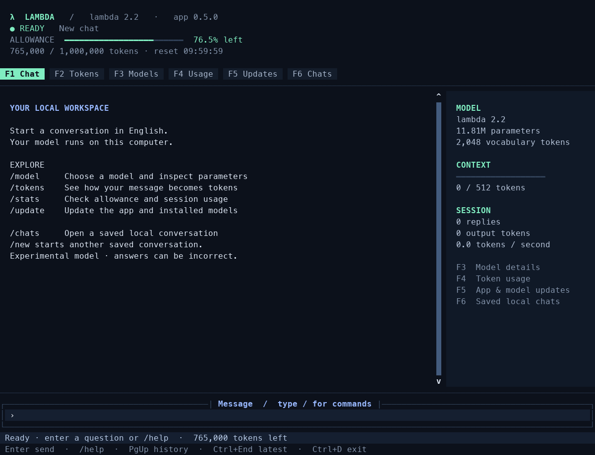
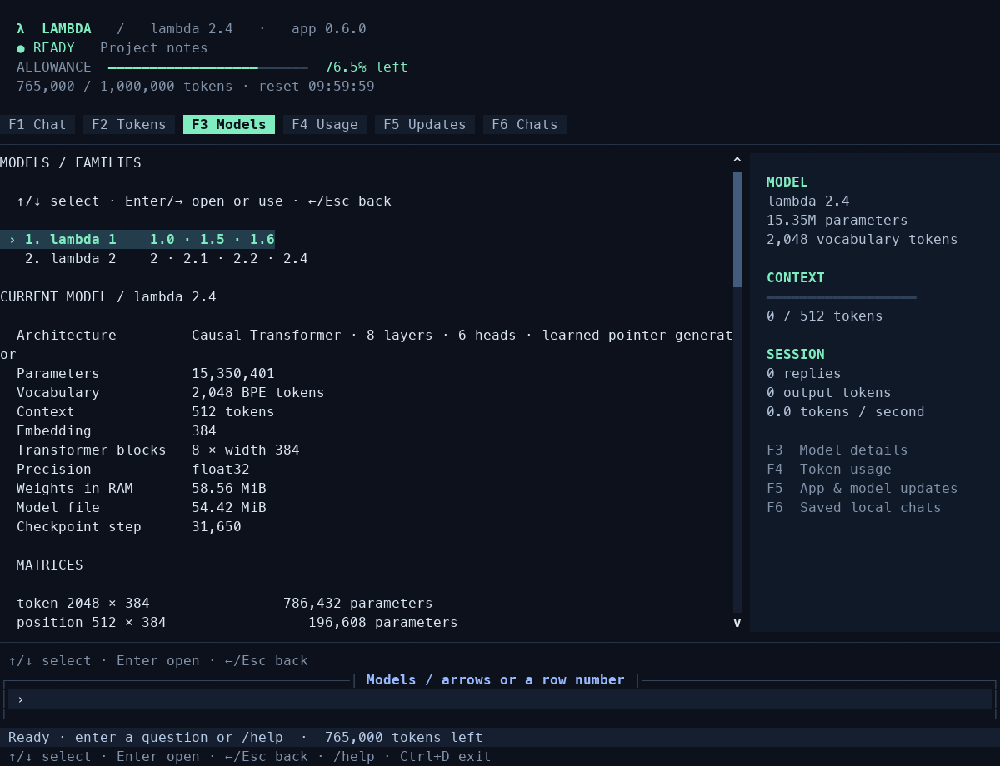

# λ Lambda AI

**A local English AI chat application for your terminal.**
Type `lambda` to open a full-screen chat, inspect actual BPE tokens, explore
model parameters, and check your allowance. The bundled **lambda 1.0** model
was trained from random weights with a locally learned tokenizer.

```text
  λ  L A M B D A   /   local English AI
  1,000,000 / 1,000,000 tokens left · reset after first message

  F1 Chat       F2 Tokens       F3 Models       F4 Usage
  ──────────────────────────────────────────────────────
  YOU
  What is a cat?

  λ LAMBDA
  A cat is a mammal with fur, whiskers, and paws with claws.

  › Message or command
```

This is a small educational model, not a general-purpose assistant. It can
give incorrect or nonsensical answers. Published MLP models process questions
separately. The runtime (0.4.0 and newer) also supports experimental v3/v4
Transformers: they receive recent completed exchanges within their context window.
Use `/memory` to check the current model. Interactive conversations are saved locally
and resume after restart. `/new` creates another chat; `/chats` reopens a saved one.
The model still sees only its recent context window. Optional conversation models through lambda 2.4 are available.

## Install

Requires **Python 3.11+**. On macOS or Linux:

```bash
git clone https://github.com/gtts-ux/lambda_ai.git
cd lambda_ai
bash install.sh
lambda
```

The installer creates `.venv` inside the project and links `lambda` into
`~/.local/bin`, without `sudo`. If needed, it prints the PATH setting to add.
Keep the project in its installation location; if you move it, recreate the
environment and install again. Dependencies require internet during installation.
The English model is included, so chat then works offline.

Standard Python installation, also usable on Windows:

```bash
python -m venv .venv
# macOS / Linux:
.venv/bin/python -m pip install .
.venv/bin/lambda
# Windows:
# .venv\Scripts\python -m pip install .
# .venv\Scripts\lambda
```

Distribution name: `lambda-ai-terminal`. Installing the package adds the
standard `lambda` console entry point to that Python environment.



Terminal preview with a sample allowance.

## Terminal controls

| Key | Action |
| --- | --- |
| F1 | Chat |
| F2 | Live token inspector, including IDs and generated tokens |
| F3 | Model choices, parameter count and matrix shapes |
| F4 | Remaining allowance, reset time and session usage |
| F5 | App and model updates |
| F6 | Saved local chats |
| ↑ / ↓ | Select a model family, version or chat with empty input |
| Enter / → | Open a family, select a model or reopen a chat |
| ← / Esc | Go back; Esc cancels question editing |
| Ctrl+P | Pin/unpin the selected chat in Chats |
| Ctrl+E / Ctrl+R | Edit the last question / regenerate its answer in Chat |
| Ctrl+N | New saved chat |
| Enter | Send a message or run a command |
| PgUp / PgDn | Scroll |
| Ctrl+C | Cancel an operation or clear the input |
| Ctrl+D | Exit |

The sidebar adapts to terminal width. Slash commands support completion,
and the input supports session history with the arrow keys.

```text
/help
/tokens What is a cat?
/intent Explain Python 3
/model
/model use lambda-1.0
/update
/stats
/temperature 0.4
/limit 120
/topk 8
/new
/chats
/chat 1
/rename Work notes
/save conversation.json
/exit
```

`/model` offers **lambda 1.0**, **lambda 1.5**, **lambda 1.6**, **lambda 2**, **lambda 2.1**, **lambda 2.2**, and **lambda 2.4**. In the full-screen view, select a family first, then a version using ↑/↓ and
Enter (or →). For example, **lambda 1** contains 1.0, 1.5 and 1.6;
**lambda 2** contains the published 2.x versions. Use ← or Esc to go back.
Numbers select a row at the current level. `/model use <id>` selects a version directly.
The plain terminal mode keeps a numbered flat list. Lambda 1.0 remains included with the app;
lambda 1.5, 1.6 and 2 are optional downloads. Future models appear after `/update` when
the maintainer adds them to the catalog. New models are not given automatic names.

### lambda 1.5: elementary mathematics

Lambda 1.5 has **1,867,520 parameters — exactly 2.5× lambda 1.0**. Its English
training includes small integer addition, subtraction, multiplication and exact
division, with digits tokenized individually. Answers come from the neural
model; no calculator or answer lookup is used during generation.

```text
/update
/model use lambda-1.5
```

The same commands work in an existing installation; the inference format is
compatible with app 0.1.0. Earlier models remain selectable. Arithmetic is still
fallible: see the [lambda 1.5 model card](models/lambda-1.5.md) and its measured
benchmark results before relying on it. Switching models preserves the allowance.

### lambda 1.6: conversational intent

Lambda 1.6 has **2,614,528 learned parameters — exactly 3.5× lambda 1.0**.
It continues the owner's locally trained lambda 1.5 with wider layers, an
80-token context, an expanded vocabulary, and a small learned intent head.
In chat mode, fixed text features also feed the existing learned first layer
to help recognize topics across different word orders. This adds no answer lookup.

The intent head distinguishes a calculation from a conversation that happens
to contain numbers. For example, `2+2` asks for math, while `Explain Python 3`
and `I have 2 cats` call for conversational responses. Its prediction conditions
the language model; it does not evaluate expressions or look up answers.
The detected mode appears in the status line and response JSON.

**Lambda 1.6 needs app 0.2.0 or newer.** Upgrade an existing checkout first:

```bash
git pull
bash install.sh
lambda
```

Then select the model:

```text
/update
/model use lambda-1.6
/intent Explain Python 3
```

The command-line inspector is `lambda intent "Explain Python 3" --json`.
Routing probabilities concern the type of request, not whether an answer is true.
Classification, arithmetic and conversation remain fallible; see the
[lambda 1.6 model card](models/lambda-1.6.md) for measured results and limitations.
Models 1.0 and 1.5 remain supported by app 0.2.0.

### lambda 2: continued local training

Lambda 2 has **4,553,728 learned parameters**, two 1,024-unit hidden layers,
and 100,000 additional generator training steps from the owner's lambda 1.6.
It keeps an 80-token context, learned Chat/Math routing and English generation.
It works with **app 0.2.0 or newer**, so existing 0.2.0 users can select it directly:

```text
/update
/model use lambda-2
```

CLI equivalent: `lambda update`, then `lambda model use lambda-2`.
The release contains the trained final checkpoint, rather than the step-0
baseline originally selected by the validation criterion. It remains experimental;
more training does not guarantee better answers. See the
[lambda 2 model card](models/lambda-2.md) for the checkpoint decision, comparison
with 1.6, and known regressions. All earlier models and the shared allowance remain available.

## Token allowance

Each local OS user receives **1,000,000 tokens per 10-hour window**. The window
starts with the first message. This is approximately **5,000 exchanges at
200 input + output tokens each**, not a guarantee of exactly 5,000 messages.

- Used input context and actually generated tokens count toward the allowance.
- Stop-marker tokens count; padding and input discarded beyond the context do not.
- Unused output reservations are refunded. Near the limit, the output cap shrinks.
- Chat is blocked when there are not enough tokens for the input and one output token.
- The allowance resets automatically after 10 hours.
- Restarting, `/new`, switching models and model updates do not reset usage.
- SQLite transactions coordinate concurrent `lambda` processes.

This is a **local limit per OS account**, not a server-enforced account or
subscription shared across devices. State is stored under
`~/.local/share/lambda-ai` on macOS/Linux, or `%LOCALAPPDATA%\LambdaAI` on Windows.
`XDG_DATA_HOME` and `LAMBDA_DATA_HOME` can set the application data location.
No account, API key, telemetry or paid text-generation API is used.

The model's context (**64 tokens in 1.0/1.5; 80 in 1.6/2**) is separate from the allowance. A larger
allowance does not increase how much of one question the model can see.

## Model updates

```bash
lambda update
lambda model list
lambda model use lambda-1.0
```

`/update` and `lambda update` explicitly fetch
[`models/catalog.json`](https://github.com/gtts-ux/lambda_ai/blob/main/models/catalog.json)
and update revisions of already installed models. Newly named models appear
in `/model`; choose one to install and use it. Model files are downloaded
to the user data directory and checked against their size, SHA-256 and
supported inference format before installation. Failed downloads keep the
previous working model. Switching back to an installed model works offline.

In app **0.5.0 and newer**, these commands also check and install application
updates. Restart after an app upgrade, then repeat `/update` if a model revision
requires the new runtime. App 0.4.x needs a one-time package upgrade to enable
self-updates. Current model names and release rules are in [MAINTAINER.md](MAINTAINER.md).

## Scriptable commands

```bash
lambda ask "What is a cat?"
lambda ask "What is the internet?" --seed 7 --json
lambda tokens "Hello, world!" --json
lambda intent "Explain Python 3" --json
lambda info --json
lambda usage --json
lambda chat --plain
lambda --version
```

`ask --json` reports text, actual output token IDs, used/dropped context,
charged tokens, speed, elapsed time and finish reason. All chat entry points
use the same allowance. Token inspection and model information are free.
Pipes automatically use plain mode. A custom inference model can be specified
with `lambda --model file.npz` or `LAMBDA_MODEL`.

Interactive conversations save automatically on this computer. `/save` additionally
exports a copy and never overwrites an existing export. The separate usage ledger
records token counts without conversation text.

## Model and source

The bundled model is an autoregressive MLP with **747,008 parameters**, two
hidden `tanh` layers, a **1,024-token BPE vocabulary**, and **64-token context**.
Inference uses float32 NumPy arrays on CPU. The application includes no
training loop, gradients or optimizer state. Chat never modifies model weights.

[MODEL_CARD.md](MODEL_CARD.md) documents the English dataset and limitations.
The model checksum and checkpoint step are included in
`lambda_cli/assets/model.json`. Code and included inference weights are
licensed under [MIT](LICENSE).

## Development

```bash
python -m pip install -e .
python -m unittest discover -s tests -v
python -m pip wheel --no-deps . -w dist
```

The wheel includes the app and default model. GitHub Actions runs tests on
Linux and Windows. No training dataset, trainer or saved optimizer is shipped.

## lambda 2.1: experimental conversation model

Lambda 2.1 has 11,808,385 parameters and a 512-token conversation context.
It is published at the owner's request despite failing the original quality gates.
It remains unreliable at copying, remembering details and arithmetic; see the
[model card and measured results](models/lambda-2.1.md).

Upgrade the application before downloading this v4 model. In your checkout:

```bash
git pull --ff-only
.venv/bin/python -m pip install .
lambda update
lambda model use lambda-2.1
```

On Windows, use `.venv\Scripts\python -m pip install .` for the installation step.
In the terminal app, `/update` refreshes models and `/model use lambda-2.1` selects it.
`/memory` explains context; `/new` starts another chat and `/chats` reopens saved ones.
App 0.4.x needs a package upgrade; app 0.5.0 and newer also self-update through `/update`.

## lambda 2.2: conversation repair

Lambda 2.2 continues the owner's own lambda 2.1 weights with all layers trainable
and mixed multi-turn examples. App 0.4.1 also fixes NumPy 2 float64 promotion in
Transformer inference. See the [model card](models/lambda-2.2.md) for measured
before/after conversations and remaining limitations. This is still an experimental
small model; its responses are generated entirely by the neural network.

```bash
git pull --ff-only
.venv/bin/python -m pip install .
lambda update
lambda model use lambda-2.2
```

On Windows, use `.venv\Scripts\python -m pip install .`. Restart an already running
app. Starting with app 0.5.0, `/update` updates both application code and models.

## App 0.5.0: terminal workspace and self-updates

The terminal workspace includes a live **remaining allowance bar**, percentage,
remaining tokens and reset countdown. Green, amber and red indicate the remaining
budget. The same 1,000,000-token / 10-hour ledger is used across sessions and models.
Model context is shown separately. The sidebar collapses in smaller terminals.

Messages have distinct speaker labels, response token counts and elapsed time.
Click a tab or use F1–F6. PgUp reads earlier messages; Ctrl+End follows the latest
response. F5 opens **Updates** with download progress and installation results.
F6 opens **Chats**, where entering a number returns to an earlier conversation.

`/update` (or `lambda update`) now checks **both the application and models**.
The app wheel is downloaded from this repository, checked against its byte count,
SHA-256 and package identity, and installed into the Python environment running
Lambda. It does not reset the allowance or erase your installed models. A catalog
check keeps the current conversation unless the active model itself was replaced.

After an app upgrade, exit and reopen Lambda to use the new code. On Windows, the
verified app update is queued until Lambda exits because the console launcher can
be locked; wait for installation to finish before reopening. Installation details
are written to `updates/install.log` in Lambda's data directory. `/updates` opens
activity without starting another update. Cancellation is available while checking
or downloading; an installation already in progress is allowed to finish.

**One-time upgrade from app 0.4.x:** those versions cannot update their own code.
Run these commands from your checkout once:

```bash
git pull --ff-only
.venv/bin/python -m pip install .
```

On Windows, use `.venv\Scripts\python -m pip install .`. Future app upgrades can
then be started with `/update`; no `git pull` is needed for those installed updates.

## Local conversations

Interactive chats are saved automatically in `chats.sqlite3` in Lambda's user data
directory. Each chat has a title, model, generation settings and its own history.
Reopening the app returns to the last active chat. Chat data stays on your computer.

- `/new` creates a new conversation while preserving the previous one.
- `/chats` or F6 lists conversations; enter a number in that view or use `/chat <number or id>`.
- `/rename Work notes` changes the current chat's title. The first message supplies a default title.
- `/save filename.json` remains an optional export. Normal interactive use saves automatically.

Restored conversation text is supplied to Transformer models within their context
window (512 tokens for lambda 2.1/2.2). The full transcript can be longer than that
window. MLP models still process questions independently. Saved transcripts do not
train the model or create unlimited memory. Switching chats does not reset usage.

A model selected inside a conversation is remembered with that chat. Install its
model before reopening it if you removed the model file. Custom models retain their
local file path. Concurrent edits from two windows are preserved as separate copies.
`lambda ask` stays a standalone, scriptable request; interactive chat saving applies
to `lambda`, `lambda chat` and their `--plain` mode. Earlier conversations that were
closed before automatic saving existed cannot be recovered from the model weights.

## lambda 2.4

The owner's new model release is **lambda 2.4**. It continues lambda 2.2 with
15,350,401 parameters, eight Transformer layers and 150,000 training examples.
It is the selected step-7000 checkpoint, not the final step-8000 weights.
See the [model card and generated-answer results](models/lambda-2.4.md).
The private working version was not published as a lambda 2.3 model choice.

App **0.5.1** supports its larger, checksum-verified download (up to 64 MiB).
Run `lambda update`, restart the app after its application upgrade, then:

```bash
lambda update
lambda model use lambda-2.4
```

App 0.5.0 may report an invalid model size before completing its application
upgrade; restart the upgraded app and refresh again. Existing saved chats keep
their selected model. Use `/model use lambda-2.4` inside a chat to switch it,
or `/new` to start another conversation.


## App 0.6.0: models and conversation tools



Preview with an isolated sample allowance.

F3 groups published models by family and version. ↑/↓ selects a row, Enter/→ opens
it, and ←/Esc returns to the family list. The active version, download status and
size remain visible alongside the current model's parameter information.

F6 searches and pins local conversations. Type words and press Enter, or use
`/search words`, to match titles and message text. `/search` clears the filter.
↑/↓ and Enter reopen a result. Ctrl+P pins/unpins the highlighted chat; pinned chats
stay first. `/pin` toggles the current chat, and `/pin <number or id>` targets a listed
chat. Searching and pinning do not run the model or spend tokens.

The Chat action bar offers **New chat**, **Regenerate** and **Edit question**.
Ctrl+E (or `/edit`) prefills the last question; change it and press Enter. Esc cancels.
Use `/edit 2` to edit question 2, or `/edit 2 replacement question` to resend directly.
Question numbers are shown beside your messages. Ctrl+R or `/retry` generates the
last answer again. These actions create a separate saved chat branch: earlier turns
are retained, and later turns from the original branch are excluded from the new
prompt. The original chat remains available in F6. Generating again spends input
and output tokens normally; previous generations are not refunded.

The owner-approved **lambda 2.5** is being prepared privately with a 1024-token
context and additional natural dialogue, follow-up, long-context and worked-math
training examples. It is not in the public model catalog yet. Lambda 2.4 remains
available with its original 512-token context. App features do not add answer rules,
retrieve canned answers or calculate replies for the model.


## App 0.7.0: experimental web research

`/web What is the hottest planet?` searches public web results, reads up to three
sources and supplies short excerpts to the current Transformer. The terminal shows
**Searching**, **Reading**, and **Thinking / generating** as those operations run.
F7 or `/sources` shows the source titles, links, retrieval time and excerpts. Type a
question in the Web tab to search again. Ctrl+C cancels the operation.

`/web on` enables research for each question in the current chat; `/web off` returns
to offline chat. New chats inherit the current mode. A **Web: On/Off** button is in
the Chat action bar. `/read https://example.org/page Your question` reads a specified
public page without a search. `lambda ask "Your question" --web` is the scriptable
form; `--json` includes the sources with the actual generated text and token counts.

Only your query goes to search providers; saved conversation history is not uploaded.
This mode needs internet and a Transformer with at least 256 context tokens. It
uses [DDGS](https://github.com/deedy5/ddgs) with public search backends, without an
API key or another AI model. Provider outages, blocked pages, and pages requiring
JavaScript may fail. An unread result snippet is explicitly marked as a search
snippet, not a successfully read page. Source requests have byte/time limits;
private/local addresses and credential-bearing URLs are rejected, including redirects.

Source excerpts are selected by word relevance and displayed separately from the
**experimental model draft**. They are never substituted for the neural answer.
The excerpts actually supplied to the model count as input tokens under the existing
allowance; web failure/cancellation before generation spends no model tokens.
Search results and the web preference are saved with local chats. A short web answer
is capped to fit the evidence in the model window; long source pages are not all sent
to a model with 512-token context. Titles/URLs are displayed by the app; the model
is not trusted to invent citations. A displayed source is not proof that every
claim in the draft is supported by it.

**Current limitation:** lambda 2.4 does not reliably answer from supplied evidence.
For example it answered `Paris` after receiving a source explicitly naming Canberra
as Australia's capital. A live search read three public astronomy pages, but the
model draft was wrong. This is a functioning search/reader preview, not a claim
that browsing has made the model generally knowledgeable. Check the evidence and
original pages. No failed 2.5 training weights are installed or published. The name
2.5 remains reserved for a future model that passes source-grounded answer checks;
2.4 weights have not been silently renamed as a new trained model.
